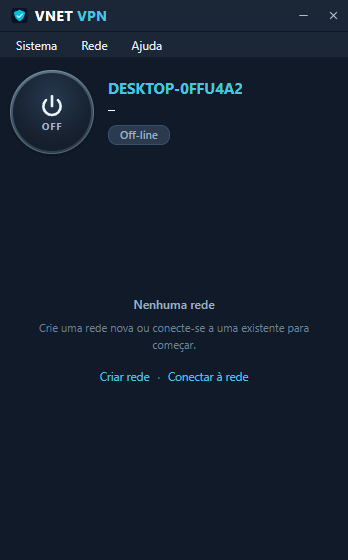
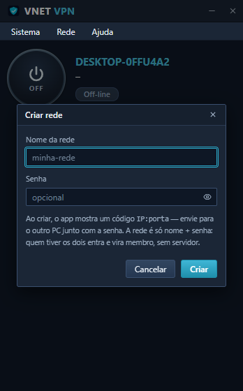

# VNET VPN

**VPN de rede local ponto a ponto, sem servidor.** Crie uma rede com nome e senha, convide o outro PC e jogue Minecraft (ou qualquer jogo LAN) como se estivessem no mesmo roteador.

[](LICENSE)





---

## O que é

O VNET cria um adaptador de rede virtual no seu PC e liga esse adaptador ao PC do outro jogador por UDP cifrado. Para o jogo, é uma LAN normal: descoberta automática de mundos, conexão direta por IP, qualquer porta.

- **Sem conta, sem servidor, sem nuvem.** A rede é um par `nome + senha`.
- **Sem dono.** Todos os PCs são membros iguais; cada um deriva o próprio IP virtual e fala direto com os outros.
- **IP fixo por máquina.** O endereço `10.144.0.X` é derivado do id persistente do PC e não muda entre sessões.
- **Cifrado de ponta a ponta** com ChaCha20-Poly1305; quem não sabe a senha nem completa o handshake.
- **Achado automático na mesma LAN.** Mesmo nome e mesma senha, sem trocar código nenhum.

> Este projeto nasceu **inspirado** na praticidade de VPNs de rede local como o Radmin VPN: abrir o app, criar uma rede com nome e senha, jogar. O protocolo, o código e a arquitetura daqui são originais — não há código de terceiros nem engenharia reversa de binários alheios. Nenhuma afiliação com produtos comerciais; marcas citadas pertencem aos seus donos.

## Como funciona

```
   PC A 10.144.0.206                          PC B 10.144.0.155
 ┌──────────────────┐                      ┌──────────────────┐
 │ Minecraft / jogo │                      │ Minecraft / jogo │
 ├──────────────────┤                      ├──────────────────┤
 │  adaptador VNET  │                      │  adaptador VNET  │
 ├──────────────────┤   UDP + ChaCha20     ├──────────────────┤
 │   malha VNET     │◄────────────────────►│   malha VNET     │
 └──────────────────┘                      └──────────────────┘
            ▲                                       ▲
            └───────── HELLO / PEERS (gossip) ──────┘
```

1. **Identidade da rede** — `room_hash = SHA-256("vnet-room-hash" ‖ nome ‖ 0 ‖ senha)`. A chave de dados vem de HKDF sobre outro hash do mesmo par, com o `room_hash` como salt. Nome ou senha errados ⇒ nada atravessa.
2. **Endereçamento** — id persistente de 8 bytes em `%LOCALAPPDATA%\vnet\node_id`; IP virtual `10.144.0.2–254` derivado por hash desse id.
3. **Handshake** — `HELLO` simétrico (sem ACK, sem "host"): troca id, IP virtual e endpoint. Quem já conhece alguém recebe por `PEERS` a lista dos demais e conecta direto neles.
4. **Dados** — cada pacote IP vira `DATA` cifrado, com `(origem, seq)` para deduplicar repasse. Broadcast de LAN (`224.0.2.60`, usada pelo Minecraft) é replicado para todos os membros.
5. **Descoberta** — sozinho, o nó envia `HELLO` em broadcast a cada 3 s nas portas UDP 7000–7100, então dois PCs na mesma rede se acham sem código.
6. **NAT** — STUN para descobrir o endpoint público e UPnP para mapear a porta; sem nenhum dos dois, o roteador precisa de um encaminhamento UDP manual.

Especificação completa do protocolo: [`SPEC.md`](SPEC.md).

## Requisitos

| Item | Versão |
|---|---|
| Windows | 10 ou 11 (x64) |
| Rust | 1.75+ (stable) |
| Node.js | 20+ |
| Visual Studio Build Tools | C++ Desktop (para o MSVC) |
| WebView2 | já vem no Windows 11 |
| [Wintun](https://www.wintun.net/) | 0.14.1 — copie `wintun.dll` (amd64) ao lado do executável |

O adaptador virtual exige **Administrador** para ser criado. Ao conectar sem elevação, o app grava os dados em `%LOCALAPPDATA%\vnet\pending.json`, se relança via UAC e conecta sozinho.

## Compilar e rodar

```bash
git clone https://github.com/spekofc/VNET-VPN.git
cd VNET-VPN

# 1. Baixe o wintun.dll (amd64) de https://www.wintun.net/
#    e coloque em: apps/desktop/src-tauri/wintun.dll

# 2. Frontend
cd apps/desktop
npm install
npm run build

# 3. App
cd src-tauri
cargo build --release --features custom-protocol
```

Saída:

```
apps/desktop/src-tauri/target/release/vnet-desktop.exe
```

Copie o `wintun.dll` junto com o executável se for levar para outro PC.

### Modo desenvolvimento

```bash
cd apps/desktop
npm run tauri dev
```

### Testes do núcleo

Sem privilégios de administrador — os testes injetam e capturam pacotes IP no lugar do adaptador:

```bash
cargo test -p vnet-core --test p2p_tunnel
```

Cobrem handshake e RTT, tráfego cifrado ponta a ponta, entrada de um terceiro nó por gossip e descoberta na LAN sem código.

## Usar

1. Abra o `vnet-desktop.exe` e aceite a elevação quando pedir.
2. **Rede → Criar rede**: nome e senha.
3. No outro PC: **Rede → Conectar à rede**, mesmo nome, mesma senha e o **código de um membro** (`IP:porta` mostrado no primeiro PC).
4. Status **Online** nos dois: o IP virtual do outro PC aparece no cartão da rede.
5. No jogo, abra o mundo para LAN e conecte por **Conexão direta → `10.144.0.X:porta`**.

Na mesma rede física basta o nome e a senha iguais — o app se encontra sozinho.

Guia detalhado, incluindo encaminhamento de porta no roteador: [`COMO-JOGAR.md`](COMO-JOGAR.md).

## Estrutura

```
vnet/
├── crates/
│   ├── vnet-crypto/     # AEAD, ECDH P-256, HKDF, HMAC, assinaturas
│   ├── vnet-proto/      # Frames, handshake e mensagens (protocolo base)
│   ├── vnet-nat/        # STUN, ICE, hole punching
│   ├── vnet-tun/        # Adaptador TUN multiplataforma
│   ├── vnet-core/       # ★ malha em uso: p2p.rs, Wintun, sessão
│   ├── vnet-ipc/        # Plano de controle local (JSON-RPC)
│   ├── vnet-cli/        # CLI
│   ├── vnet-tui/        # Painel de terminal (ratatui)
│   └── vnet-gui/        # Protótipo alternativo em egui
└── apps/
    └── desktop/         # App Tauri 2 + React + TypeScript
```

O app desktop usa `vnet-core::p2p` (malha sem dono). Os demais crates são a base multiplataforma em construção.

## Limites atuais

- Adaptador TUN implementado para **Windows** (Wintun); Linux/macOS ainda não.
- Sem servidor de rendezvous: é preciso **um** membro alcançável (UPnP ou porta encaminhada) para o primeiro contato. Depois disso a malha se espalha sozinha.
- Dois membros atrás de NAT simétrico conversam por repasse através de um terceiro nó — funciona, com a latência dele.
- Chat, pastas compartilhadas e "iniciar com o Windows" ainda são maquete na interface.
- A chave da sala deriva da senha: não há *forward secrecy* por sessão. Use uma senha longa e exclusiva.

## Licença

[AGPL-3.0](LICENSE). Se você oferecer o VNET como serviço de rede, o código das modificações precisa continuar aberto.
